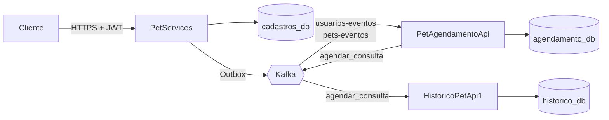

# PetServices — Cadastros e autenticação

API de cadastro de uma clínica veterinária: donos, pets, veterinários, atendentes e administradores, com login por **JWT**. É o ponto de entrada de um sistema de **3 microsserviços** que conversam por eventos no **Kafka**.

| Serviço | Responsabilidade |
|---|---|
| **PetServices** (este) | Login, cadastros e publicação dos eventos de cadastro |
| [PetAgendamentoApi](https://github.com/carolinebrunheti/PetAgendamentoApi) | Agendamento de consultas |
| [HistoricoPetApi1](https://github.com/carolinebrunheti/HistoricoPetApi1) | Histórico de consultas |
| [PetServicesK8s](https://github.com/carolinebrunheti/PetServicesK8s) | Manifests Kubernetes, CI/CD e testes de carga (k6) |

## Arquitetura



Cada serviço tem o **próprio banco**. Os outros serviços conhecem donos, pets e veterinários pelos eventos que este publica (consistência eventual), e validam o JWT emitido aqui sem precisar chamá-lo.

## Tecnologias

Java 17 · Spring Boot 4 · Spring Security (OAuth2 Resource Server, JWT HS256) · Spring Data JPA · PostgreSQL 17 · Flyway · Apache Kafka 4 · JUnit 5 · Mockito · Testcontainers · Docker · GitHub Actions

## Endpoints

| Rota | Métodos | Quem pode |
|---|---|---|
| `/auth/login` | POST | Público |
| `/dono`, `/dono/{id}` | GET | Admin, atendente, veterinário |
| `/dono`, `/dono/{id}` | POST, PUT, DELETE | Admin |
| `/pet`, `/pet/{id}` | GET | Qualquer usuário logado (o tutor só vê os próprios pets) |
| `/pet`, `/pet/{id}` | POST, PUT, DELETE | Admin, atendente |
| `/veterinario`, `/veterinario/{id}` | GET | Qualquer usuário logado |
| `/veterinario`, `/veterinario/{id}` | POST, PUT, DELETE | Admin |
| `/atendente`, `/admin` (e `/{id}`) | GET, POST, PUT, DELETE | Admin |
| `/actuator/health` | GET | Público (usado pelo Kubernetes) |

As listagens são paginadas: `?page=0&size=10&sort=nome,asc` (no máximo 50 por página).

## Decisões de projeto

- **Padrão Outbox.** O cadastro e o evento são gravados **na mesma transação** (tabela `tb_outbox_evento`); um publicador lê a tabela a cada 1 s e envia ao Kafka. Assim, com o Kafka fora do ar, nenhum cadastro é perdido: os eventos saem quando ele volta. Antes do Outbox, um teste com o Kafka fora deixou 331 donos sem chegar ao Agendamento.
- **Falha rápida.** Com o Postgres fora, a API responde **503 com `Retry-After`** em ~3 s, em vez de prender a requisição por 30 s e devolver 500.
- **Login protegido.** Senhas com BCrypt; depois de 5 tentativas erradas o IP fica bloqueado por 15 min (429); a resposta é a mesma para email inexistente e senha errada, para não revelar quais emails estão cadastrados.
- **JWT validado por inteiro.** Além da assinatura e da validade, o token precisa ter `id` e um `role` conhecido; caso contrário, 401.
- **Primeiro admin** criado a partir de variáveis de ambiente quando o banco está vazio (fora do profile `dev`).

## Testes

**116 testes**, rodando no GitHub Actions a cada push e pull request:

- **Unitários e de controller** (Mockito, MockMvc).
- **Integração com Testcontainers**: a aplicação sobe contra **Postgres e Kafka reais** em contêineres e verifica o fluxo de ponta a ponta (migrations, login, cadastro → Outbox → Kafka).
- **Segurança**: token expirado, assinado com outro segredo, sem assinatura (`alg: none`) ou adulterado; papéis sem permissão; tutor tentando ver o pet de outro tutor; força bruta no login.

```bash
./mvnw test        # precisa do Docker rodando (Testcontainers)
```

O sistema também passou por testes de caos (Kafka, Postgres e pods derrubados) e de carga com k6 (até 150 usuários simultâneos sem falhas) num cluster AKS. Detalhes no [PetServicesK8s](https://github.com/carolinebrunheti/PetServicesK8s).

## Como rodar localmente

Pré-requisitos: Java 17 e Docker.

```bash
# 1. variáveis de ambiente (o .env não vai para o Git)
cp .env.example .env
# edite o .env: DB_PASSWORD e JWT_SECRET (gere com: openssl rand -hex 32)

# 2. Postgres, Kafka e Kafka UI (http://localhost:8090)
docker compose up -d

# 3. a API, com dados de exemplo (usuários com senha 123456)
./mvnw spring-boot:run -Dspring-boot.run.profiles=dev
```

A API sobe em `http://localhost:8081`. Para testar:

```bash
curl -X POST localhost:8081/auth/login -H 'Content-Type: application/json' \
  -d '{"email":"admin@petservices.com","senha":"123456"}'
```

Use o `token` da resposta no header `Authorization: Bearer <token>`. O mesmo `JWT_SECRET` precisa estar no `.env` dos outros dois serviços.
